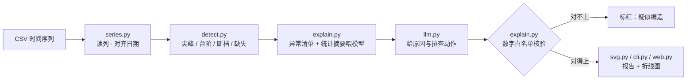

# Shixu · Time Series Anomaly Explainer

[](https://github.com/wushiyi105-jpg/shixu/actions) []() [](./LICENSE) [](https://codecov.io/gh/wushiyi105-jpg/shixu)

Drop in a CSV time series; it finds the anomalies, then asks the model to explain them in plain language.

The algorithm handles "what is off", the model handles "why it might be, and what to check first", and then the program goes back and verifies every number the model said — anything that does not match the data gets flagged.


## What it actually does

Three things, in this order:

1. **Find the points.** Rolling median + MAD catches single spikes, a before/after window comparison catches steps, gap detection catches interruptions, empty values are reported separately.
2. **Explain.** The anomaly list, a statistical summary and your business context go to the model, which must give causes, actions to check, and a confidence level.
3. **Verify.** Any number in the explanation must be findable in the anomaly values, baselines or summary. If it is not, it was invented, and it gets flagged.

Step 3 is the part I care most about. Models love padding anomaly explanations with numbers: "affected roughly 30% of users", "probably 5000 orders lost". They cannot compute those; the numbers exist to make the sentence feel complete. So I do not let it compute — only cite.

## The three algorithms

| Detection | Method | Default threshold |
| --- | --- | --- |
| Spike / drop | Rolling median and MAD from the points before it, robust Z score | window 14, Z 3.5 |
| Step | Median of the front window vs the back window, and the next window must hold | window 7, 2.0 × MAD |
| Gap | Adjacent interval exceeds a multiple of the typical interval | 2× |
| Missing | The value on that row is empty | — |

Robust Z uses median and MAD rather than mean and standard deviation because anomalies drag the mean and SD themselves: three big promo days can double a month's SD, and then nothing gets caught.

One more rule that looks minor but matters: **no spike detection at the start**. The first 7 points have no decent baseline, MAD is absurdly small, and any wiggle counts as "20 MADs off".

## A real rework: the step detector reported 16, all noise

The first version, on the sample data, produced this for the daily-active column:

```
异常：尖峰 2、骤降 6、台阶 16、断档 1、缺失 1
```

I had planted 5 anomalies; it reported 26. The step detector was the worst offender — 16 of them, spread from September 15 to October 20, almost every day "switching step".

Three root causes:

**One: the mean is too fragile.** Windows were compared by mean. I planted a drop to 900 on October 3; whichever window it landed in had its mean dragged down by 100+, so several neighbouring positions "detected a step" at once. Switch to median: one 900 among 7 points barely moves the median.

**Two: one step gets reported seven or eight times.** Sliding point by point, a single real step pushes seven or eight neighbouring positions over the threshold. Add non-maximum suppression: sort by score, drop every other candidate in the same window.

**Three: the starting point drifts.** After de-duplication the surviving position is often not the first day of the step — when scores tie it lands a day or two before (the median inside the window has already flipped, so the score is the same). So push forward to the day that actually sits on the new level, then walk back to the first point already at that level.

After the fix, same dataset:

```
异常：尖峰 1、骤降 1、断档 1、台阶 1、缺失 1
4. [台阶] 2026-10-16，值 2597（基线 3368）
```

The start point lands exactly on October 16, the day I planted the step. 26 became 5, and the 5 match the 5 I planted one for one.

I also added: once a step is recognised, the "drops" in the following window are usually just its echo — the median is still at the old level, so of course the new value looks like a fall. Anything within ±15% of the new step gets suppressed.

## Number verification had its own trap: 31 false warnings

The first verifier's allow-list held only anomaly values, baselines and the summary. Running the sample, every explanation came back with red lines under it:

```
可能原因：9 月 21 日出现历史最高值 6200，最可能是大促……
! 这句里的数字对不上数据：9, 21, 9, 9, 21
```

**A date is not data.** The model repeating "September 21" is exactly its job; I treated 9 and 21 as invented values. A mechanism that fires on every normal output is the same as no mechanism at all.

Fix: strip date shapes before verification — `2026-09-21`, `9月21日`, `9/21`, `9-21`, `10月`, `9 点 30 分` all stop counting as data; small integers (≤5) are let through as indices; numbers the program wrote into `note` itself ("隔了 4 个周期", "正常约 24 小时") join the allow-list.

After the fix, same batch of explanations: **0 false warnings**. And deliberately writing "大概涨了 30%" still gets caught — 30 is not in the allow-list and is not a date.

These are pinned in the unit tests: `test_date_is_not_data` asserts five date formats do not warn, `test_fabricated_percent_caught` asserts "30%" must be caught.

## Data flow

How one piece of data moves between the modules:



## Quick start

```bash
git clone https://github.com/wushiyi105-jpg/shixu.git && cd shixu
cp .env.example .env      # fill in LLM_API_KEY

python -m shixu add samples/daily-active.csv --note "自营商城，9 月中做过一次大促，月底上了新版首页"
python -m shixu detect 1 --out reports/日活异常报告.md
```

Algorithm only, no model:

```bash
python -m shixu detect 1 --no-model
```

Start the Web UI:

```bash
python -m shixu serve        # http://127.0.0.1:8770
```

## Commands

| Command | What it does |
| --- | --- |
| `add <csv...> --name --note` | Import CSV, de-duplicated by content hash. First column is time, every column that converts to numbers is a metric |
| `list` | Dataset list and detection counts |
| `detect <id> [--column] [--window] [--z] [--shift-ratio] [--no-model] [--json] [--out]` | Run detection and store it; optionally export markdown |
| `show <id>` | Dataset overview and last detection time per column |
| `svg <id> --column --out` | Export an SVG line chart with anomalies circled |
| `rm <id>` / `stats` / `serve` | Delete a dataset / stats / start the Web UI |

Business context in `--note` goes into the prompt. Writing "月底上了新版首页" makes the model's causes far more specific — it is the only context the algorithm cannot see.

## The Web UI

Datasets and metrics on the left, chart plus anomaly list on the right. The chart is inline SVG, no charting library: a 960×300 string, the line breaks at missing values, anomalies are circled (red spike, yellow drop, blue step, grey dashed gap).

The "algorithm only" button does not call the model, so you can quickly check whether the thresholds fit.

## Design trade-offs

- **Zero third-party dependencies.** CSV, statistics, SVG, HTTP — all standard library. The lighter the setup, the more likely someone actually runs it.
- **One shape for every anomaly.** `{kind, index, time, value, baseline, deviation, note}`, five types sharing one field set, so neither the frontend nor the prompt needs branching.
- **A model failure loses no data.** If the explanation dies, anomalies still get stored, and the report says "the model explanation did not run: API 429".
- **Each detection overwrites the same column**, no history stacking. Re-running after a threshold change is routine; a pile of old results just makes it unclear which one to read.
- **The mean stays out of the report.** The summary carries a mean, but explanations always talk in medians — a more stable meaning.

## Tests

```bash
python -m unittest discover -s tests
```

127 cases, all offline: model calls are replaced by doubles, HTTP starts a real server on `port=0` and hits it. Covers nine time formats when reading CSV, five missing-value markers, three false-positive shapes for steps (single-point contamination, back-and-forth bouncing, gentle slope), date verification, SQLite de-duplication and overwrite, and SVG line breaks at missing values.

Running the tests also turned up a real bug: the CLI subcommands never closed their sqlite connections, so on Windows even a temp database could not be deleted — `PermissionError: 文件被占用`. Fixed by closing uniformly in `main()`'s `finally`, which also silenced Python 3.13's `ResourceWarning` stream.

## Configuration

`.env` (already in `.gitignore`):

```
LLM_API_KEY=...
LLM_BASE_URL=https://open.bigmodel.cn/api/paas/v4
LLM_MODEL=glm-4.6
```

Works with any OpenAI-style `/chat/completions` endpoint — DeepSeek and Ollama both plug in. `--api-key --base-url --model` override it for one run.

---

Author: shiyi
Email: wushiyi105@gmail.com
GitHub: [wushiyi105-jpg](https://github.com/wushiyi105-jpg)
